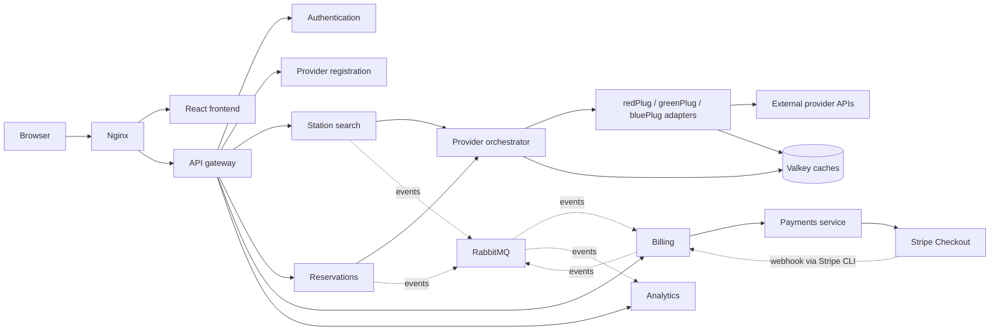

# saasPlug

**One platform for EV drivers, charging providers, and platform operators.**

saasPlug brings charging stations from redPlug, greenPlug, and bluePlug into a shared map. Drivers can find and reserve stations, providers can manage their operations and invoices, and operators can monitor activity across the platform.

Developed for the **NTUA ECE Software as a Service course, 2026 — Team 12**.

## Contents

- [Features](#features)
- [Architecture](#architecture)
- [Quick start](#quick-start)
- [Configuration](#configuration)
- [External integrations](#external-integrations)
- [Demo data](#demo-data)
- [Development and testing](#development-and-testing)
- [API overview](#api-overview)
- [Troubleshooting](#troubleshooting)
- [License](#license)

## Features

| Role | Capabilities |
| --- | --- |
| **EV driver** (`ev_user`) | Browse the station map, filter availability, inspect station details, create reservations, and view or cancel reservations. |
| **Charging provider** (`provider`) | Register a provider account, view and update station status, monitor reservations and analytics, manage invoices, pay through Stripe Checkout, download invoice PDFs, and export activity logs as CSV or JSON. |
| **Platform operator** (`operator`) | View global analytics, inspect reservations and stations across providers, manage provider accounts, and assign user roles. |

The platform supports Google sign-in, JWT access and refresh tokens, and a separate demo login mode. Reservation, billing, and analytics services exchange events through RabbitMQ; provider adapters use Valkey caches to reduce upstream API calls.

## Architecture



The core services use separate MongoDB databases for users, providers, stations, reservations, billing, and analytics. Docker Compose runs the application and infrastructure on the `saasplug-net` network.

| Service | Source | Internal port | Responsibility |
| --- | --- | --- | --- |
| `web-frontend` | [web-frontend/](web-frontend/) | 3000 | React 18, TypeScript, and Vite UI; Leaflet maps and Recharts dashboards. |
| `api-gateway` | [api-gateway/](api-gateway/) | 4000 | API routing, JWT verification, and request rate limiting. |
| `auth-service` | [auth-service/](auth-service/) | 5001 | Google sign-in, token issuance, user roles, and first operator setup. |
| `provider-service` | [provider-registration/](provider-registration/) | 5002 | Provider onboarding, metadata, pricing, and client credentials. |
| `stations-service` | [stations-importer/](stations-importer/) | 5003 | Station search, cached station data, and provider station management. |
| `reservation-service` | [reservations/](reservations/) | 5004 | Reservation creation, status, cancellation, and domain events. |
| `billing-service` | [billing/](billing/) | 5005 | Reservation charges, invoice creation, billing periods, and payment confirmation. |
| `analytics-service` | [analytics/](analytics/) | 5006 | Event ingestion, provider/global analytics, and log exports. |
| `provider-orchestrator` | [provider-orchestrator/](provider-orchestrator/) | 5007 | Aggregates station data and routes requests to provider adapters. |
| `payments` | [payments/](payments/) | 5008 | Creates hosted Stripe Checkout sessions. |
| `redplug-service` | [redplug/](redplug/) | 5010 | redPlug API adapter. |
| `greenplug-service` | [greenplug/](greenplug/) | 5011 | greenPlug API adapter. |
| `blueplug-service` | [blueplug/](blueplug/) | 5012 | bluePlug API adapter. |

Shared JWT, RabbitMQ, cache, logging, and station status utilities live in [packages/shared-utils/](packages/shared-utils/). Backend services use Node.js and Express; Docker images use Node.js 20.

## Quick start

### Prerequisites

- Git.
- Docker with the Docker Compose v2 plugin, with the Docker daemon running.
- Access to the external charging provider APIs for station data and reservations.
- Node.js 20+ and npm if you want to develop locally or run the API seed script.
- GNU Make is optional for the repository shortcuts.

### 1. Clone the repository

```bash
git clone https://github.com/ntua/saas26-12.git
cd saas26-12
```

### 2. Create your configuration

```bash
cp .env.example .env
```

Edit `.env` and replace `JWT_SECRET` and `INTERNAL_AUTH_TOKEN` with separate random values. For example, run the following command once for each secret:

```bash
openssl rand -hex 32
```

Keep `ALLOW_DEV_LOGIN=true` for a local demo. Google credentials can remain blank in this mode. Configure provider API keys if the upstream APIs require them.

The example Stripe values allow the billing and payments services to initialize, but checkout requires valid Stripe test credentials. See [External integrations](#external-integrations) before testing payments.

### 3. Start the application

```bash
docker compose up -d --build nginx
docker compose ps
```

Starting `nginx` also starts its application and infrastructure dependencies. The Stripe CLI listener is started separately when configuring payments.

| Interface | Address |
| --- | --- |
| Web application | [http://localhost](http://localhost) |
| Alternative web address | [http://localhost:8080](http://localhost:8080) |
| Public API base | [http://localhost/api](http://localhost/api) |
| RabbitMQ management | [http://localhost:15672](http://localhost:15672) |

RabbitMQ uses the `RABBITMQ_USER` and `RABBITMQ_PASS` values from `.env` (both default to `saasplug`). Application service ports and MongoDB ports are internal to Docker.

### 4. Create the first operator

Open the application and complete the **first launch** form to create an operator account. In demo mode, enter an email and display name. After signing out, use the demo role selector to try the EV Driver, Provider, and Operator views.

Provider accounts must complete registration through their **Account** page before provider-specific features can resolve their charging network.

## Configuration

[.env.example](.env.example) is the configuration template. Docker Compose reads the root `.env` file automatically.

| Variable | Purpose |
| --- | --- |
| `JWT_SECRET` | Signs access and refresh tokens. Replace the example value. |
| `JWT_EXPIRES_IN`, `JWT_REFRESH_EXPIRES_IN` | Token lifetimes; defaults are `15m` and `7d`. |
| `INTERNAL_AUTH_TOKEN` | Shared secret for internal service calls. Replace the example value. |
| `ALLOW_DEV_LOGIN` | Enables the demo login UI, role selection, and demo authentication endpoints; defaults to `true`. |
| `GOOGLE_CLIENT_ID`, `VITE_GOOGLE_CLIENT_ID` | Backend and frontend Google client IDs. Use the same value for both. |
| `FRONTEND_URL` | Frontend origin; defaults to `http://localhost`. |
| `REDPLUG_API_BASE_URL`, `GREENPLUG_API_BASE_URL`, `BLUEPLUG_API_BASE_URL` | Upstream provider API URLs; the template includes the course endpoints. |
| `REDPLUG_API_KEY`, `GREENPLUG_API_KEY`, `BLUEPLUG_API_KEY` | Provider credentials where required. |
| `RABBITMQ_USER`, `RABBITMQ_PASS`, `RABBITMQ_URL` | Broker credentials and connection URL. Keep the URL credentials in sync with the user and password. |
| `STATIONS_CACHE_TTL_SEC` | Station cache lifetime; defaults to `300` seconds. |
| `STRIPE_SECRET_KEY` | Stripe secret API key for hosted checkout and the local webhook listener. |
| `STRIPE_WEBHOOK_SECRET` | Signing secret emitted by the Stripe CLI listener. |

The template also includes `GOOGLE_CLIENT_SECRET` and `GOOGLE_CALLBACK_URL`. The current frontend sends Google ID tokens to the backend, which verifies them using `GOOGLE_CLIENT_ID`.

`VITE_*` values are embedded in the frontend at build time. Rebuild `web-frontend` after changing its Google client ID or `ALLOW_DEV_LOGIN`:

```bash
docker compose up -d --build web-frontend auth-service
```

For a deployment that uses real accounts, configure Google sign-in and set `ALLOW_DEV_LOGIN=false` to disable demo access. Keep `.env` and API keys out of Git; `.env` is already ignored.

## External integrations

### Charging providers

The adapters connect to the redPlug, greenPlug, and bluePlug endpoints configured in `.env`, normalize station data, and forward reservations. Station discovery and reservations depend on upstream connectivity; cached data may remain available during an outage. The repository does not include an offline provider simulator.

### Google sign-in

Set `GOOGLE_CLIENT_ID` and `VITE_GOOGLE_CLIENT_ID` to your Google web client ID, configure the client to allow the frontend origin you use, then rebuild the frontend and recreate the auth service. With Google enabled, the first launch screen can create the first operator through Google sign-in.

### Stripe payments

Use Stripe **test credentials** for the course demo:

1. Set `STRIPE_SECRET_KEY` in `.env` to your Stripe test secret key.
2. Start the listener and inspect its logs:

   ```bash
   docker compose up -d stripe-cli
   docker compose logs stripe-cli
   ```

3. Copy the listener's `whsec_...` signing secret into `STRIPE_WEBHOOK_SECRET` in `.env`.
4. Recreate the services so they load the updated values:

   ```bash
   docker compose up -d --no-deps --force-recreate billing-service payments
   ```

The Compose listener forwards events directly to `billing-service:5005/api/invoices/webhooks/stripe`. An invoice becomes paid after the billing service validates the completion webhook. Returning from Checkout alone does not mark it paid.

## Demo data

After the application is running, you can create sample accounts and attempt provider registration and reservations through the API:

```bash
make seed
```

Without Make, use `node scripts/seed.js`. This script requires Node.js 20+, `ALLOW_DEV_LOGIN=true`, and a reachable API. Provider registration and reservation results depend on the external course API; the script uses a demo provider key.

| Role | Seeded email |
| --- | --- |
| Operator | `operator@saasplug.demo` |
| EV driver | `alice@example.com` |
| Provider | `founder@coolcharge.demo` |

Use those emails with the matching role in the demo login form. To populate analytics charts and sample invoices directly in the running databases:

```bash
make seed-analytics
make seed-billing
```

`make seed-charts` runs both database seed scripts. Analytics data covers the last 30 days by default; `DAYS=60 make seed-analytics` changes the range. Billing data defaults to `redPlug`; `PROVIDER=greenPlug make seed-billing` changes the provider.

Repeated analytics and billing seeds can add duplicate demo records. `WIPE=1 make seed-analytics` clears **all analytics logs** before seeding; `WIPE=1 make seed-billing` replaces its sample invoices. Use these options only with disposable demo data.

## Development and testing

### Frontend development

Keep the Docker stack running, then start Vite locally:

```bash
cd web-frontend
npm install
npm run dev
```

Open [http://localhost:3000](http://localhost:3000). Vite proxies `/api` requests to `http://localhost`; set `API_PROXY_TARGET` if your Docker entry point uses another address. Set `VITE_GOOGLE_CLIENT_ID` and `VITE_DEV_LOGIN` in the local frontend environment when changing its authentication options.

Build the frontend with `npm run build` from `web-frontend/`.

### Service tests

Install the shared utilities and run the existing Node.js test suites:

```bash
npm --prefix packages/shared-utils install
for service in analytics billing payments provider-registration; do
  npm --prefix "$service" install || exit 1
  npm --prefix "$service" test || exit 1
done
```

The current `make test` target searches a `services/` directory, while the service packages live at the repository root. Use the commands above for these suites.

### Performance checks

With k6 installed and the application running:

```bash
k6 run tests/performance_test.js
```

The script runs load and stress scenarios against the frontend at `http://localhost/`. See [PERFORMANCE_REPORT.md](PERFORMANCE_REPORT.md) for the recorded results. A Postman collection is available in [tests/API_Collection.json](tests/API_Collection.json).

### Useful Docker commands

```bash
docker compose logs -f --tail=100
docker compose logs -f api-gateway reservation-service
docker compose --env-file .env.example config --quiet
docker compose down
```

`docker compose down` preserves database volumes. To remove the containers **and permanently delete the stored database data**, use `docker compose down -v` (`make reset`).

The [Makefile](Makefile) also provides `make ps`, `make logs`, `make build`, and `make rebuild`. `make up` starts the entire stack, including the Stripe CLI listener, and expects its Stripe configuration to be ready.

## API overview

All public API groups are served through Nginx and the API gateway under `/api`.

| Prefix | Main operations |
| --- | --- |
| `/api/auth` | Sign-in, token refresh, current user, first operator setup, and operator user management. |
| `/api/providers` | Provider registration, lookup, and account updates. |
| `/api/stations` | Search stations, retrieve details, and manage a provider's stations. |
| `/api/reservations` | Create, list, inspect, and cancel reservations. |
| `/api/invoices` | List invoices, inspect outstanding charges, create or draft invoices, and start Checkout. |
| `/api/analytics` | Provider analytics, global operator analytics, and CSV/JSON exports. |

Protected operations use `Authorization: Bearer <accessToken>`. Station search is public; provider, reservation, billing, and analytics operations apply their own authentication and role checks.

## Troubleshooting

| Symptom | Check |
| --- | --- |
| Application does not open | Confirm Docker is running, inspect `docker compose ps` and the Nginx/gateway logs, and ensure host ports 80 and 8080 are available. |
| Empty station map or provider errors | Check provider URLs, API keys, and network access; inspect `provider-orchestrator` and adapter logs. |
| Provider dashboard has no account data | Complete provider registration and associate the account with its provider system. |
| Google button is missing | Set `VITE_GOOGLE_CLIENT_ID` and rebuild the frontend. |
| Demo login is missing or returns 404 | Check `ALLOW_DEV_LOGIN`; rebuilding the frontend is required when changing this flag. |
| Invoice remains unpaid after Checkout | Verify the Stripe listener is running and `STRIPE_WEBHOOK_SECRET` matches its current signing secret; inspect billing logs. |
| RabbitMQ connection fails | Ensure `RABBITMQ_URL` uses the same credentials as `RABBITMQ_USER` and `RABBITMQ_PASS`. |

## License

This project is distributed under the [MIT License](LICENSE).
